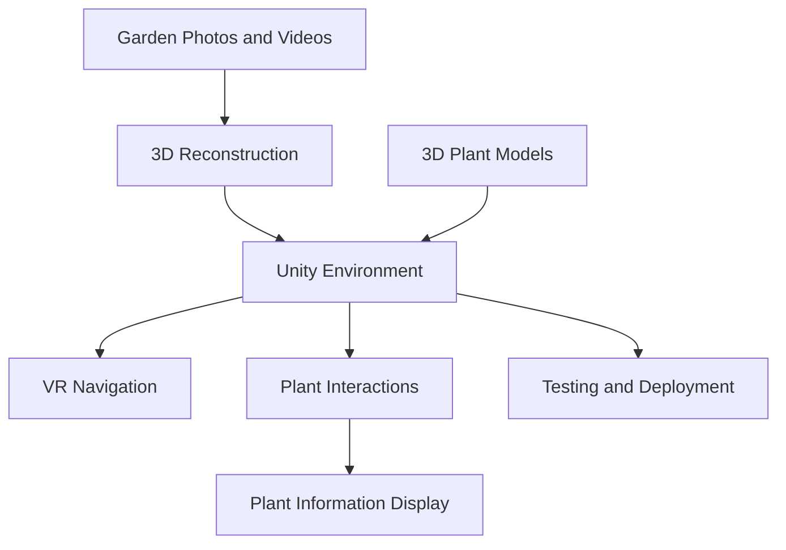

# Oregon Garden VR - Technical Design

## 1. System Overview

Oregon Garden VR is a virtual reality application that allows users to explore digital representations of real-world gardens and vegetation in Oregon. The project uses Unity and investigates 3D reconstruction techniques, including Gaussian Splatting, to create realistic garden environments. Users will be able to navigate a virtual garden, observe different types of vegetation, and interact with plants to learn more about them. Additional features, such as different seasons and times of day, are planned. The project is currently in its early development stage. The team has established the Unity project, implemented basic model interactions, and set up automated testing. Reconstruction tools and VR hardware compatibility are still being evaluated.

## 2. System Architecture

The application uses Unity as its main development environment. Garden imagery will be processed through a reconstruction pipeline and imported into Unity, where users can explore and interact with the environment.

The Unity project and basic interaction scripts currently exist. The reconstruction pipeline, VR controls, and plant information display are still being developed or evaluated.

### Component Responsibilities

| Component | Responsibility | Status |
|-----------|----------------|--------|
| Unity Environment | Manages garden scenes, lighting, and vegetation | In development |
| 3D Reconstruction | Converts captured imagery into garden models | Under evaluation |
| VR Controls | Handles movement, head tracking, and object selection | Planned |
| Plant Interaction | Detects user interaction with vegetation | Basic prototype |
| Plant Information | Displays information about selected plants | Planned |
| Testing and CI | Runs automated tests and builds | Implemented |

## 3. Technology Stack

| Component | Technology |
|-----------|------------|
| Game Engine | Unity 6000.6.6f1, Universal Render Pipeline |
| Programming Language | C# |
| 3D Reconstruction | Gaussian Splatting (under evaluation) |
| VR Interaction | Unity XR Interaction Toolkit (planned) |
| Testing | Unity Test Framework (NUnit) |
| Continuous Integration | GitHub Actions with GameCI |
| Version Control | Git / GitHub |
| Distribution | GitHub Releases (planned) |

## 4. System Components and Interfaces

### 4.1 Garden Reconstruction

The team plans to capture photographs and videos of real gardens in Oregon and use 3D reconstruction tools to create realistic digital representations of vegetation. Gaussian Splatting is currently being evaluated as a possible reconstruction method. The selected tools must produce assets that can be imported into Unity and rendered efficiently in VR.

### 4.2 Unity Environment

Unity will serve as the main development environment for the project. It will manage the garden scene, vegetation models, lighting, and user interactions. The team plans to combine reconstructed assets with additional 3D models if needed to create a complete garden environment.

### 4.3 VR Interactions

Users will navigate the garden using a VR headset and interact with vegetation through headset or controller input. The planned interaction system will allow users to select plants and view information such as their names, descriptions, and characteristics. The exact implementation will depend on the selected headset and Unity's supported VR interaction tools.

### 4.4 Plant Information

Plant information will be associated with vegetation objects in the Unity environment. When a user selects a plant, the application will retrieve the corresponding information and display it through a user interface. The storage format and implementation of this feature have not yet been finalized.

## 5. Testing and Deployment

### 5.1 Automated Testing

The project uses Unity Test Framework and GitHub Actions with GameCI.

Current PlayMode tests are located in `Assets/Tests/PlayMode/OregonVR.PlayModeTests.cs` and include:

- `BasicPlayModeTest`: Verifies that Unity can create a GameObject.
- `ModelClickListener_LogsMessage`: Verifies that `HandleClick()` logs `"User click"`.

The CI workflow is located at `.github/workflows/blank.yml`. It is configured to run tests and produce build artifacts. The team has also tested whether breaking the interaction script causes CI to fail.

### 5.2 VR Deployment

The Fall Week 10 walking skeleton is planned to include one garden scene, at least one reconstructed plant, and basic VR viewing functionality. The application will be distributed through GitHub Releases so an outside tester can download and run the build.

**Hardware Compatibility:** The current CI pipeline produces Windows 64-bit builds. This may work for PC-connected VR headsets, but standalone headsets such as Meta Quest require a different build target.

The team must confirm the target headset with the project partner before finalizing the build configuration and deployment process. Manual testing will verify navigation, rendering quality, and VR performance.

## 6. Architectural Decisions and Alternatives

One major technical decision is whether to use Gaussian Splatting, traditional 3D modeling, or a combination of both.

| Approach | Advantages | Limitations |
|----------|------------|-------------|
| Gaussian Splatting | Realistic reconstruction of captured gardens | Potential performance and interaction limitations |
| Traditional 3D Models | Easier object selection and customization | Requires additional modeling work |
| Hybrid Approach | Realistic environments with interactive 3D plants | Requires combining different asset types |

The team will continue developing the initial prototype using traditional 3D assets while evaluating Gaussian Splatting. A hybrid approach may be considered if Gaussian Splatting provides realistic environments but makes individual plant interactions difficult. The final decision will depend on Unity compatibility, visual quality, and VR performance testing.

## 7. Open Questions and Next Steps

The following decisions still need to be finalized:

- **VR Headset:** Confirm which headset will be used and update the build pipeline accordingly.
- **Gaussian Splatting:** Select a compatible reconstruction tool and test its performance.
- **Plant Interactions:** Expand the current interaction script to display plant information.
- **Navigation:** Determine whether teleportation or smooth movement is more suitable.
- **Performance:** Test rendering quality and frame rate on the target headset.

The team will continue updating this document as these decisions are made and the prototype develops.
