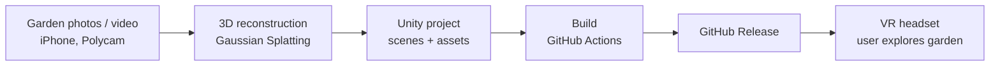

# Oregon Garden VR – Technical Design

## 1. System Overview
This project creates an immersive virtual reality experience that lets users explore digital representations of real-world gardens and vegetation in Oregon. It uses Unity as its development environment and explores 3D reconstruction techniques, including Gaussian Splatting, to create realistic plants and garden environments. Users will navigate a virtual garden, observe different types of vegetation, and learn about the plants in it.

The project is in its early stage. The team is setting up the Unity project, evaluating reconstruction tools, collecting garden imagery, and building a first prototype. Features that are not implemented yet are described as planned.

## 2. System Architecture

Only the Unity project (C) and the CI build (D) exist today. Reconstruction (B) is being evaluated, and distribution (E–F) is planned for Week 10.

## 3. Technology Stack
| Component | Choice |
|---|---|
| Game engine | Unity 6000.6.6f1, Universal Render Pipeline |
| Language | C# |
| 3D reconstruction | Gaussian Splatting (tool under evaluation) |
| VR interaction | Unity XR Interaction Toolkit (planned) |
| Tests | Unity Test Framework (NUnit) |
| CI | GitHub Actions with GameCI |
| Version control | Git / GitHub |

## 4. Interfaces and Contracts

### 4a. Reconstruction-to-Unity Interface
The reconstruction pipeline must produce assets that the selected Unity splatting plugin can import and render correctly. The supported file format, import process, and compatibility requirements will be fixed after the team selects and tests a reconstruction package.

### 4b. Unity Scene Interface
Garden assets are organized in Unity scenes under `Assets/Scenes/`. Each scene defines the placement and scale of reconstructed objects, environmental features, and interactive components. Scene-structure changes that affect other parts of the application are documented here.

### 4c. VR Input Interface
The VR input system translates headset and controller input into application behavior: head tracking, navigation, and object selection. Exact input mappings depend on the selected headset and Unity XR packages.

### 4d. Model Selection Interface
`ModelClickListener` (`Assets/Scripts/`) is attached to a selectable model. When the model is clicked, `HandleClick()` runs. Today it logs `"User click"`; it will later open the plant's information panel (FR4).

## 5. Current Implementation
At the named commit, the repository contains:

- **Unity project:** Unity 6000.6.6f1, URP, started from Unity's starter template.
- **Scene:** `Assets/Scenes/GetStarted_Scene.unity` (starter scene; the garden scene is not built yet).
- **Script:** `ModelClickListener` in the `OregonVR.Runtime` assembly.
- **Tests:** `Assets/Tests/PlayMode/OregonVR.PlayModeTests.cs`, in the `OregonVR.PlayModeTests` assembly:
  - `BasicPlayModeTest`: checks that the Unity test runtime can create a GameObject.
  - `ModelClickListener_LogsMessage`: fails if `HandleClick()` stops logging `"User click"`.
- **CI:** `.github/workflows/blank.yml` (Section 8).

## 6. Data Model
The project works mainly with visual assets and Unity scene data:

- **Source imagery:** photographs and videos captured at the garden.
- **Reconstructed assets:** output of the selected 3D reconstruction process.
- **Unity scenes:** environment objects, cameras, lighting, and interactions.
- **Vegetation metadata:** plant names and descriptions linked to garden objects (planned).
- **Project configuration:** Unity packages, project settings, and build settings.

## 7. Deployment and Production Target

### 7a. Walking Skeleton (Fall Week 10)
The walking skeleton is the thinnest end-to-end slice: a Unity build with one garden scene and at least one reconstructed plant that a user can look around in on a VR headset.

It will be distributed as an installable build attached to a **GitHub Release** in this repository. For Week 10, "deployed" means someone outside the team downloads that release and runs it on the target headset. The Repo Checkpoint 2 cover will link to the release page.

### 7b. Ownership and Agreement
| Item | Decision |
|---|---|
| Distribution channel | GitHub Releases on 2026-2027-Capstone-Projects/OregonVR |
| Target hardware | To be confirmed with partner by Nov 13, 2026 (see P2) |
| Account / infrastructure owner | Bryden Takayama (GitHub Releases, Unity CI license) |
| Agreed by | Dr. Raffaele De Amicis (partner) |
| Agreement status | Not yet requested, will ask by Nov 6 by Shreya Suresh; awaiting confirmation. Tracked as P1 in docs/risks.md. Expected by Nov 9. |
| Outside tester for Week 10 | Dr. De Amicis or a member of his group |

## 8. Testing and Continuous Integration
**Workflow:** `.github/workflows/blank.yml`, triggered on every pull request to `main`, every push to `main`, and manually.

1. **test** job: runs the Unity Test Framework EditMode tests with `game-ci/unity-test-runner` on Unity 6000.6.6f1 and uploads the results.
2. **build** job: runs only if the tests pass; builds a Windows 64-bit player with `game-ci/unity-builder` and uploads it as an artifact.

**Safety net:** `ModelClickListener_LogsMessage` fails if `ModelClickListener.HandleClick()` stops logging its message. The team confirmed this by breaking the method on a branch and watching CI fail: https://github.com/2026-2027-Capstone-Projects/OregonVR/actions/runs/41587265763/job/125755552535.

**Merge gate:** branch protection on `main` requires the Unity Edit Mode Tests check to pass and one teammate's approval.

**Manual testing:** VR comfort, navigation, and rendering performance are tested by hand on the target headset before each release (see the Safety Net Plan in docs/risks.md).

## 9. Decisions Deferred
| Decision | Why deferred |
|---|---|
| Primary VR headset | Needs confirmation of hardware availability (P2) |
| Gaussian Splatting implementation | Needs evaluation of Unity integration and VR performance |
| Reconstruction file format | Depends on the selected reconstruction tool |
| Navigation method (teleport vs. smooth) | Needs usability and comfort testing |
| Vegetation information display | Depends on confirmed interaction requirements |

## 10. Open Technical Questions
- Which Gaussian Splatting implementation best balances visual quality and VR performance?
- How should garden footage be captured to produce usable reconstructions?
- Which reconstructed asset formats import and render reliably in Unity?
- What rendering optimizations will VR need?
- How should vegetation information be linked to reconstructed assets?
- How will the team measure rendering performance on the selected hardware?
